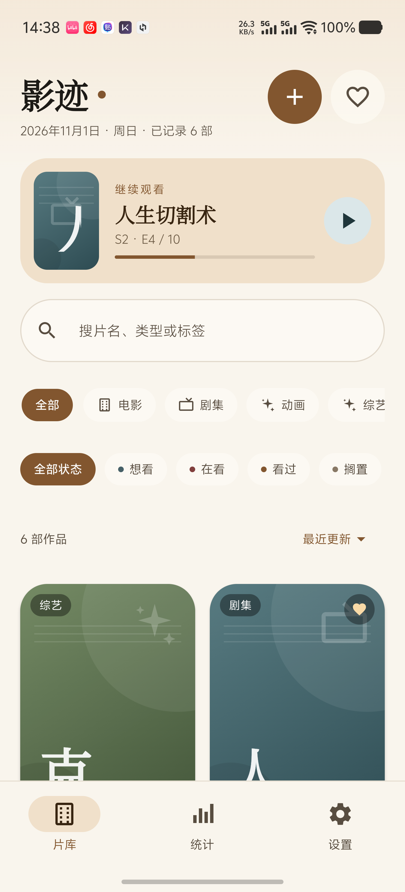
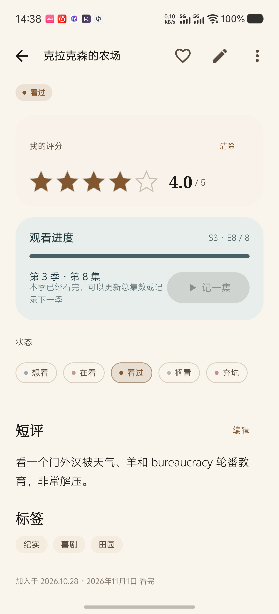
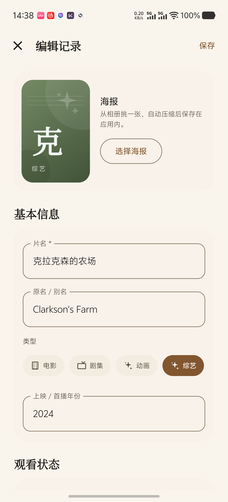
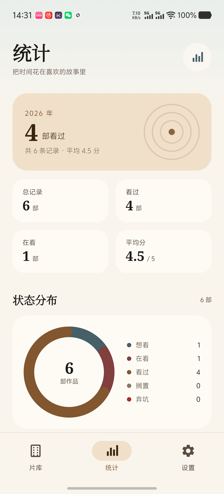
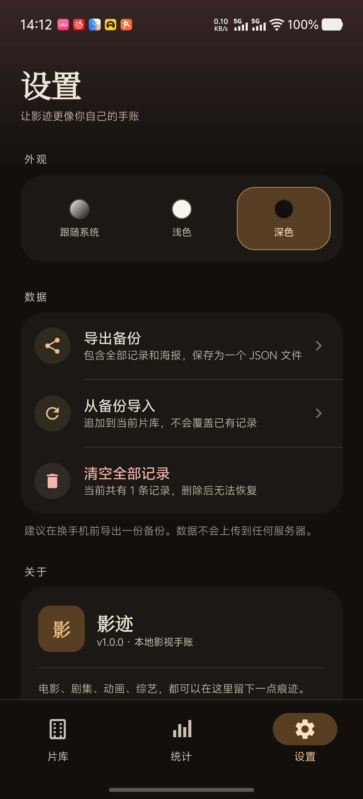

# YingJi (影迹)

**A personal, offline-first Android movie & TV journal built with Kotlin and Jetpack Compose.**

> 把看过的，都留下。

YingJi helps one person keep a private journal of films, TV series, anime, and variety shows: ratings, short reviews, episode progress, tags, and locally stored posters. The app currently works completely offline — no account system, no ads, no tracking, and no network permission.

This public page is the project reference for a TMDB API application. The planned TMDB integration is **read-only**: search for titles and fetch metadata or poster options, then let the user save a result to the local journal. Personal ratings, reviews, and watch history stay on the device.

## Screenshots

| Library | Detail |
| --- | --- |
|  |  |

| Editor | Statistics |
| --- | --- |
|  |  |

Dark theme:

## Features

- Movies, TV series, anime, and variety shows in one library
- Watchlist / watching / completed / on hold / dropped states
- Half-star ratings, short reviews, synopsis, and tags
- Season and episode progress with a one-tap "watch next episode" action
- Posters picked from the gallery, compressed and stored in app-private storage
- Search, filters by type/status/favorites, and four sort orders
- Yearly count, status donut, type distribution, rating distribution, top genres
- Light / dark / system theme
- Full JSON backup including posters
- No `INTERNET` permission: all personal data stays on the device

## Status

YingJi is a personal, non-commercial project under active development. TMDB access is not enabled yet. When the optional search is added, the app will display the required TMDB attribution and notice in its About screen.

## Technology

- Kotlin 1.9
- Jetpack Compose + Material 3
- SQLiteOpenHelper (no Room or annotation processing)
- Coroutines / StateFlow
- Android SDK 34, min SDK 26

## Source

The full Android project lives in a separate private workspace. This repository is the public project page and does not contain the application source or API credentials.

## Contact

Please open an issue in this repository for questions about the project.
